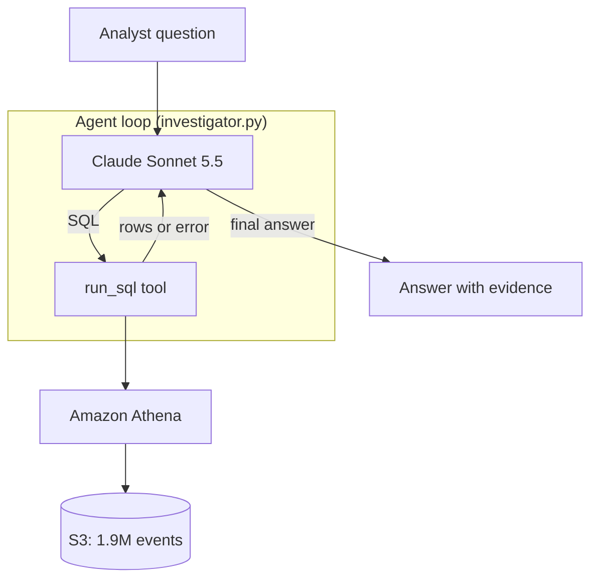
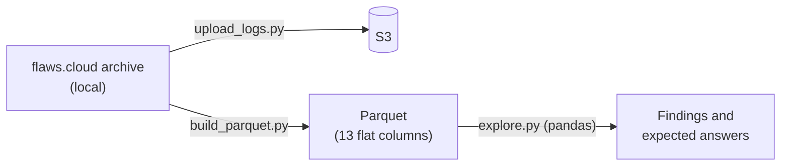

# CloudTrail AI Investigator

An AI agent that answers natural-language questions about AWS CloudTrail logs.
It writes SQL, runs it on Athena, and explains what it finds in plain English.
Planned next: background knowledge with RAG, and access from Claude Desktop through MCP.

Learning project covering: Agents, AWS (S3, Athena, IAM, Bedrock), MCP, LLM, RAG, and a vector DB.

> Work in progress. Results, diagram and demo will be added as the project progresses.

## Project goal

This is **not** an anomaly detection model, and the data has **no labels**.
It is an assistant for a security investigator.

When an alert fires in a SOC, an investigator has to reconstruct what happened:
who did what, when, from where, and whether it worked. Today that means writing
long SQL queries by hand and looking up error codes in the documentation.

The agent does this work. The investigator asks in plain English, for example
*"Did anyone try to turn off CloudTrail logging?"*, and the agent writes the SQL,
runs it on Athena, and explains the result with security context.

**How it is evaluated without labels:** a set of test questions, each with an
expected answer computed independently in pandas. The agent is scored on whether
it reaches the same answer. These question-answer pairs play the role of labels.

## Data

Public CloudTrail logs from [flaws.cloud](http://flaws.cloud) by Summit Route
(20 files, 1,939,207 real events from Feb 2017 to Oct 2020, including attack attempts).

flaws.cloud is a public security challenge (CTF): an AWS account built with
deliberate weaknesses so people can practice attacking it. The logs therefore
contain activity from many players and automated scanners over several years,
not from a single attacker.

### Anatomy of one event

Every CloudTrail event answers five questions. Example: a `StopLogging` attempt.

| Question | Columns | Example value |
|---|---|---|
| Who? | `identityType`, `userName`, `accessKeyId` | IAM user `Level6`, permanent key (`AKIA...`) |
| Did what? | `eventName`, `eventSource` | `StopLogging` on `cloudtrail.amazonaws.com` |
| When? | `eventTime` (UTC) | 2019-06-07 11:04:25 |
| From where? | `sourceIPAddress`, `userAgent` | `2.251.2.5`, AWS CLI on Linux |
| Did it work? | `errorCode`, `errorMessage` | `AccessDenied` (empty means success) |

**Reading it:** a player who obtained the level 6 keys of the challenge tried to
turn off logging to hide their tracks, and was blocked. By contrast, a successful
`DeleteTrail` by the `Root` identity two months later was most likely the account
owner doing maintenance. The same kind of action means different things depending
on *who* did it and *whether it succeeded*.

## Architecture (current state, day 3)

**How the loop works:** Claude decides when to query. Each `run_sql` call returns
either the result rows or Athena's error message. Claude reads it, then either
fixes the SQL, runs another query, or writes the final answer. A safety limit
stops the loop after 8 steps, and the tool only accepts `SELECT` queries.

**Data preparation and manual exploration** (used to validate the agent):

**Why the Claude API and not Bedrock:** the AWS account (new free plan) has a daily
token quota of 0 for every Bedrock model, and the quota is not adjustable. The
agent calls Claude through the Anthropic API instead; Athena and S3 still run on AWS.

## Progress

### Day 1: AWS setup and data exploration ✅
- Secured the AWS account (MFA, budget alert) and connected the CLI with
  short-lived credentials (`aws login`) instead of long-term access keys.
- Uploaded the logs to S3 and created an Athena table over them (schema-on-read).
- Converted the logs to Parquet and explored them with pandas (`src/eda/explore.py`).

**Key findings:**
- Two leaked IAM users (`Level6`, `backup`) generated 94% of all events.
- A burst of 1.3M `RunInstances` calls (68% of all events) came from one IP,
  `5.205.62.253`, on 21–23 Aug 2019. Only 2 of the 1,323,105 calls succeeded:
  59% were throttled (`RequestLimitExceeded`), 25% were not authorized.
- `Level6` tried to stop CloudTrail logging from Kali Linux and was denied.

### Day 2: text to SQL ✅
`src/agent/text_to_sql.py`: one question, one Claude call that writes SQL, one Athena query.

### Day 3: agent loop ✅
`src/agent/investigator.py`: Claude gets a `run_sql` tool and runs as many
queries as it needs, then answers in plain English.

## Validation: agent vs. manual analysis

Before trusting the agent, each question was first answered by hand in pandas.
The agent's answers were then compared with those results.

| Question | Manual result (pandas) | Agent result | Match |
|---|---|---|---|
| Which 5 IPs made the most `RunInstances` calls? (day 2) | `5.205.62.253` with 1,299,186 calls, then 4 smaller IPs | Same 5 IPs, same counts | ✅ Exact |
| On which day did `RunInstances` peak, who was behind it, and did anything succeed? (day 3) | 22 Aug 2019 (581,558 calls); users `Level6` and `backup`; one IP; 2 successes in the whole dataset | Same day and count, same users and IP, none succeeded on the peak days; ran 2 queries on its own | ✅ Same facts |
| Did anyone try to stop CloudTrail logging? (day 3) | 2 `StopLogging` by `Level6` (denied), 1 `DeleteTrail` by Root (succeeded) | Same events, plus an `UpdateTrail` attempt, and noticed the `StopLogging` target was a trail in a **different** account | ✅ Facts match; agent found an extra detail |

**What the comparison shows:**
- **The facts are right.** On every question the agent reached the same numbers
  as the independent pandas analysis.
- **The interpretation needs context.** The agent called Root's `DeleteTrail` the
  most serious event. The manual analysis concluded it was most likely the account
  owner doing maintenance, because flaws.cloud is a CTF and Root is the owner.
  The agent had no way to know that. This is the motivation for day 4: give the
  agent background knowledge with RAG.
