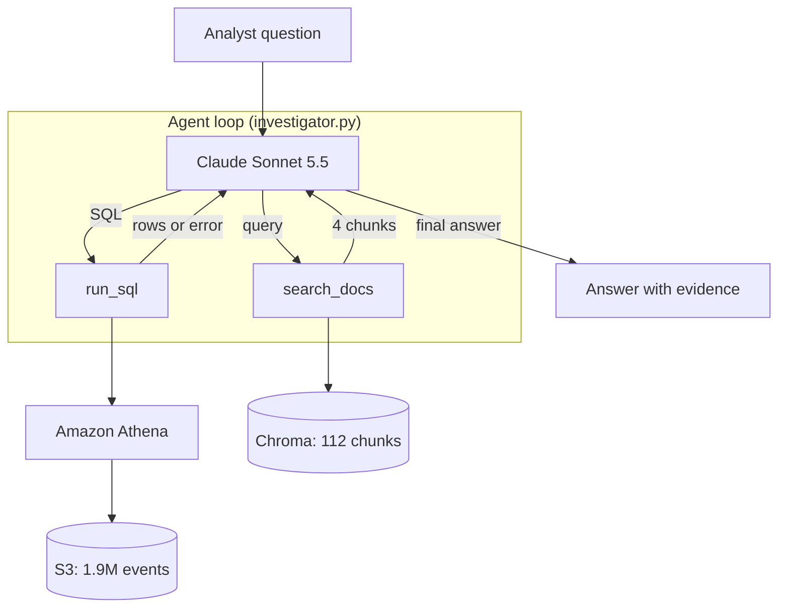
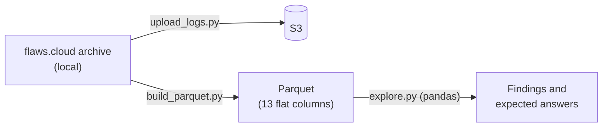

# CloudTrail AI Investigator

An AI agent that answers natural-language questions about AWS CloudTrail logs.
It writes SQL, runs it on Athena, looks up background knowledge with RAG, and
explains what it finds in plain English. Its tools are also exposed through an MCP server.

Learning project covering: Agents, AWS (S3, Athena, IAM), MCP, LLM, RAG, and a vector DB (Chroma).

> Work in progress. Results, diagram and demo will be added as the project progresses.

## Project goal

This is **not** an anomaly detection model, and the data has **no labels**.
It is an assistant for a security investigator.

When an alert fires in a SOC, an investigator has to reconstruct what happened:
who did what, when, from where, and whether it worked. Today that means writing
long SQL queries by hand and looking up error codes in the documentation.

The agent does this work. The investigator asks in plain English, for example
*"Did anyone try to turn off CloudTrail logging?"*, and the agent writes the SQL,
runs it on Athena, and explains the result with security context.

**How it is evaluated without labels:** a set of test questions, each with an
expected answer computed independently in pandas. The agent is scored on whether
it reaches the same answer. These question-answer pairs play the role of labels.

## Data

Public CloudTrail logs from [flaws.cloud](http://flaws.cloud) by Summit Route
(20 files, 1,939,207 real events from Feb 2017 to Oct 2020, including attack attempts).

flaws.cloud is a public security challenge (CTF): an AWS account built with
deliberate weaknesses so people can practice attacking it. The logs therefore
contain activity from many players and automated scanners over several years,
not from a single attacker.

### Anatomy of one event

Every CloudTrail event answers five questions. Example: a `StopLogging` attempt.

| Question | Columns | Example value |
|---|---|---|
| Who? | `identityType`, `userName`, `accessKeyId` | IAM user `Level6`, permanent key (`AKIA...`) |
| Did what? | `eventName`, `eventSource` | `StopLogging` on `cloudtrail.amazonaws.com` |
| When? | `eventTime` (UTC) | 2019-06-07 11:04:25 |
| From where? | `sourceIPAddress`, `userAgent` | `2.251.2.5`, AWS CLI on Linux |
| Did it work? | `errorCode`, `errorMessage` | `AccessDenied` (empty means success) |

**Reading it:** a player who obtained the level 6 keys of the challenge tried to
turn off logging to hide their tracks, and was blocked. By contrast, a successful
`DeleteTrail` by the `Root` identity two months later was most likely the account
owner doing maintenance. The same kind of action means different things depending
on *who* did it and *whether it succeeded*.

## Architecture (current state, day 5)

**How the loop works:** Claude decides which tool to call and when.
`run_sql` returns facts: the result rows, or Athena's error message so Claude can
fix the SQL. `search_docs` returns meaning: who an identity is, what an error code
means, which MITRE ATT&CK technique fits. It uses hybrid search (keyword BM25 plus
vector similarity, merged with Reciprocal Rank Fusion), chosen on day 7 by measurement. When Claude has enough, it writes the
final answer. A safety limit stops the loop after 8 steps, and `run_sql` only
accepts `SELECT` queries.

**MCP server** (`src/mcp_server/server.py`): exposes `run_sql`, `search_docs` and
`investigate` (the whole agent) to any MCP host over stdio. The host's own model
then decides when to call them. Tested with `src/mcp_server/try_client.py`.

**Data preparation and manual exploration** (used to validate the agent):

**Why the Claude API and not Bedrock:** the AWS account (new free plan) has a daily
token quota of 0 for every Bedrock model, and the quota is not adjustable. The
agent calls Claude through the Anthropic API instead; Athena and S3 still run on AWS.

## Progress

### Day 1: AWS setup and data exploration ✅
- Secured the AWS account (MFA, budget alert) and connected the CLI with
  short-lived credentials (`aws login`) instead of long-term access keys.
- Uploaded the logs to S3 and created an Athena table over them (schema-on-read).
- Converted the logs to Parquet and explored them with pandas (`src/eda/explore.py`).

**Key findings:**
- Two leaked IAM users (`Level6`, `backup`) generated 94% of all events.
- A burst of 1.3M `RunInstances` calls (68% of all events) came from one IP,
  `5.205.62.253`, on 21–23 Aug 2019. Only 2 of the 1,323,105 calls succeeded:
  59% were throttled (`RequestLimitExceeded`), 25% were not authorized.
- `Level6` tried to stop CloudTrail logging from Kali Linux and was denied.

### Day 2: text to SQL ✅
`src/agent/text_to_sql.py`: one question, one Claude call that writes SQL, one Athena query.

### Day 3: agent loop ✅
`src/agent/investigator.py`: Claude gets a `run_sql` tool and runs as many
queries as it needs, then answers in plain English.

### Day 4: RAG with a vector DB ✅
- Knowledge base: two short hand-written docs in `knowledge/` (dataset context and
  identities, how to read CloudTrail error codes and actions) plus the 104 MITRE
  ATT&CK techniques for cloud infrastructure (IaaS), from the official `mitre/cti` data.
- `src/rag/build_index.py` embeds them (all-MiniLM-L6-v2) into a local Chroma
  index of 112 chunks. `src/tools/rag_tool.py` searches it by meaning.
- The agent got a second tool, `search_docs`, and decides when to use it.
- The knowledge base contains only general context, **not** our findings, so the
  agent cannot "look up" the answers to the evaluation questions.

**Lessons:**
- **An up-to-date source beats model memory.** The model "remembered" logging
  tampering as MITRE T1562.008; the current ATT&CK data shows it is revoked and
  replaced by T1685.002.
- **Retrieval is imperfect.** For "thousands of RunInstances calls" the small
  embedding model ranked denial-of-service above Resource Hijacking (T1496).
  Day 7 measured this and switched to hybrid search.
- **The agent is not deterministic.** The same question can lead to a different
  search, so the right context is not always retrieved. This is why day 6 measures
  the agent on many questions instead of judging single runs.

### Day 5: MCP server ✅
`src/mcp_server/server.py` (MCP Python SDK 2.x, stdio). Over stdio, stdout carries
the MCP messages, so the tools' progress prints are redirected to stderr.

### Day 6: evaluation ✅
- `eval/questions.py`: 30 questions. Each one has a pandas function that computes the
  facts a correct answer must contain (numbers, names, dates), straight from the data.
- `eval/run_eval.py`: runs the agent on every question and checks that each fact
  appears in the answer (numbers as whole numbers, dates in several formats). It also
  records steps, tool calls, tokens, cost and time.
- 20 basic questions plus 10 harder ones: multi-step chains, time logic, traps
  (e.g. "how many DeleteBucket calls **succeeded**" where most failed), and a
  question that needs the knowledge base.
- The scorer was checked by reading answers by hand, to make sure passes are real.

### Day 7: model comparison and retrieval quality ✅

**Models** (`eval/compare_models.py`), all 30 questions:

| Model | Accuracy | Cost for 30 questions | Avg time | Avg steps |
|---|---|---|---|---|
| Claude Haiku 5.5 | 30/30 | $0.026 | 14.9 s | 2.5 |
| Claude Sonnet 5.5 | 30/30 | $0.404 | 14.1 s | 2.1 |

Both models answered every question correctly; Haiku cost about 15 times less and
needed slightly more steps. Caveat: the scoring checks facts, not the quality of the
security explanation.

**Retrieval** (`eval/eval_retrieval.py`): 18 search queries, each labelled with the
knowledge chunks that answer it.

| Search method | Recall@1 | Recall@4 (what the agent sees) | MRR |
|---|---|---|---|
| Vector (all-MiniLM-L6-v2) | 0.56 | 0.83 | 0.68 |
| BM25 keywords | 0.72 | 0.89 | 0.80 |
| **Hybrid (RRF)** | 0.67 | **0.94** | 0.80 |

Vector search alone missed technical names such as `AccessDenied` and
`GetCallerIdentity`, which keyword search finds exactly. Hybrid search combines both
and is now the agent's default. One query still fails with every method: "someone
launched many EC2 instances" has no technical keyword and its meaning is too vague.

## Validation: agent vs. manual analysis

Before trusting the agent, each question was first answered by hand in pandas.
The agent's answers were then compared with those results.

| Question | Manual result (pandas) | Agent result | Match |
|---|---|---|---|
| Which 5 IPs made the most `RunInstances` calls? (day 2) | `5.205.62.253` with 1,299,186 calls, then 4 smaller IPs | Same 5 IPs, same counts | ✅ Exact |
| On which day did `RunInstances` peak, who was behind it, and did anything succeed? (day 3) | 22 Aug 2019 (581,558 calls); users `Level6` and `backup`; one IP; 2 successes in the whole dataset | Same day and count, same users and IP, none succeeded on the peak days; ran 2 queries on its own | ✅ Same facts |
| Did anyone try to stop CloudTrail logging? (day 3) | 2 `StopLogging` by `Level6` (denied), 1 `DeleteTrail` by Root (succeeded) | Same events, plus an `UpdateTrail` attempt, and noticed the `StopLogging` target was a trail in a **different** account | ✅ Facts match; agent found an extra detail |

**What the comparison shows:**
- **The facts are right.** On every question the agent reached the same numbers
  as the independent pandas analysis.
- **The interpretation needs context.** The agent called Root's `DeleteTrail` the
  most serious event. The manual analysis concluded it was most likely the account
  owner doing maintenance, because flaws.cloud is a CTF and Root is the owner.
  The agent had no way to know that. This is the motivation for day 4: give the
  agent background knowledge with RAG.
- **With RAG (day 4)**, when the agent retrieved the dataset context it described
  Root's `DeleteTrail` as possibly the owner's own maintenance, and named the MITRE
  technique with its source. When its search did not retrieve the identities
  section, it still called it the main concern.
